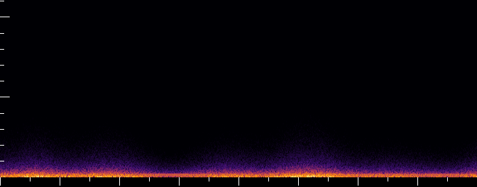
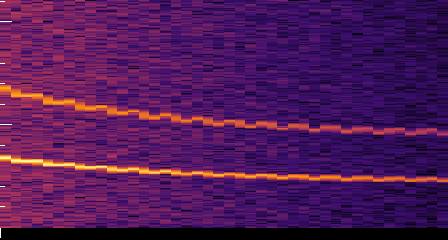
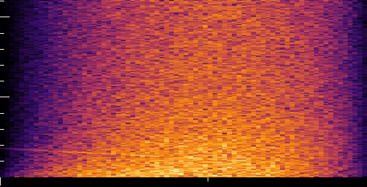
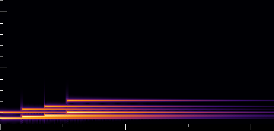
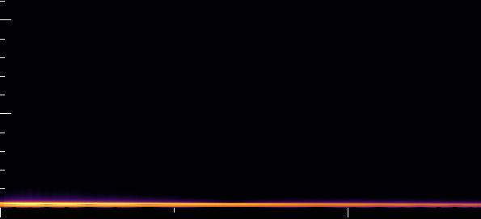
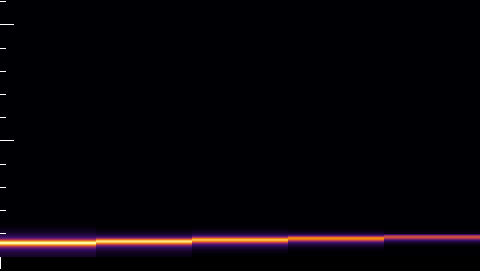
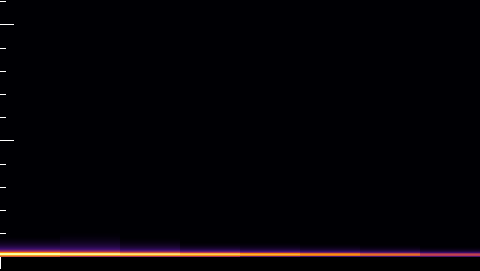

# Sounds

Generated by `cargo run -q -p gamecraft-bevy --bin gamecraft-synth-dump`; do not edit by hand.
Every effect is computed in `crates/gamecraft-bevy/src/synth.rs`, so these files are the
complete record of what the Bevy games sound like.

Spectrogram key: time runs left to right, 0 Hz is the bottom edge and 11025 Hz the top; white ticks on the left mark every 1 kHz (long every 5 kHz), ticks under the image every 0.5 s (long every 1 s). Brighter is louder, on a 90 dB range per image. FFT window 512 samples, hop 256.

| Effect | Length | Peak | RMS | Centroid | Use |
|---|---|---|---|---|---|
| [ambient](ambient.wav) | 8.00 s | -6.9 dBFS | -22.9 dBFS | 130 Hz | Murmuration bed, loops: low wind and wing rustle under two soft pad tones (110 and 165 Hz) |
| [screech](screech.wav) | 0.50 s | -3.1 dBFS | -14.5 dBFS | 4434 Hz | Murmuration: a hawk takes a starling; a sweep falling from about 3.4 kHz to 2.2 kHz with a flutter |
| [flare](flare.wav) | 0.90 s | -3.1 dBFS | -17.0 dBFS | 3667 Hz | Murmuration: the flare; a noise whoosh that brightens, over a falling sparkle |
| [win_chime](win_chime.wav) | 2.20 s | -2.5 dBFS | -16.5 dBFS | 934 Hz | Both games: win; four rising notes C5 E5 G5 C6 with a soft octave overtone |
| [loss_tone](loss_tone.wav) | 1.40 s | -3.1 dBFS | -14.4 dBFS | 159 Hz | Murmuration: loss; a low falling tone (196 to 147 Hz) |
| [blip](blip.wav) | 0.07 s | -6.0 dBFS | -15.9 dBFS | 641 Hz | Maze: one step; 70 ms rising blip |
| [bump](bump.wav) | 0.11 s | -4.4 dBFS | -14.1 dBFS | 100 Hz | Maze: a wall; 110 ms low thump |

## ambient

Murmuration bed, loops: low wind and wing rustle under two soft pad tones (110 and 165 Hz)

## screech

Murmuration: a hawk takes a starling; a sweep falling from about 3.4 kHz to 2.2 kHz with a flutter

## flare

Murmuration: the flare; a noise whoosh that brightens, over a falling sparkle

## win_chime

Both games: win; four rising notes C5 E5 G5 C6 with a soft octave overtone

## loss_tone

Murmuration: loss; a low falling tone (196 to 147 Hz)

## blip

Maze: one step; 70 ms rising blip

## bump

Maze: a wall; 110 ms low thump

